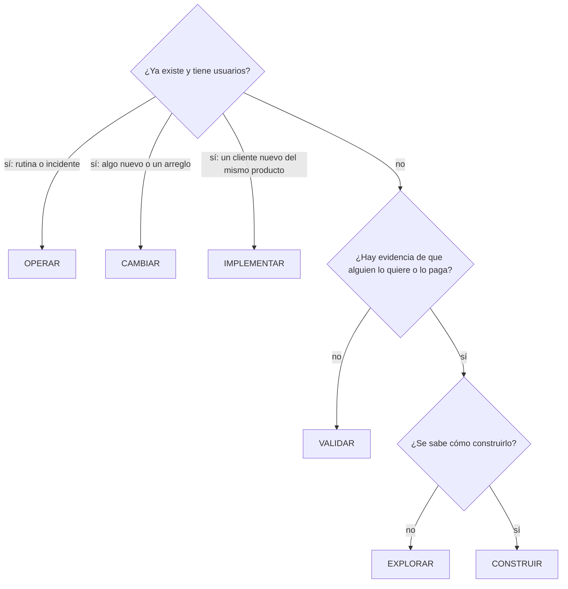

<p align="center">
  
</p>

<h1 align="center">GZSM</h1>

<p align="center">
  <strong>Metodología de software por escenario para Claude.</strong><br>
  Elegir el proceso que corresponde a cada trabajo y dejar que las skills hagan el resto.
</p>

<p align="center">
  <a href="LICENSE"></a>
  <a href="CHANGELOG.md"></a>
  <a href="https://github.com/giuliano-z/gzsm/actions/workflows/validar.yml"></a>
  
</p>

<p align="center"><a href="README.md">Read in English</a></p>

---

La mayoría de los flujos de trabajo con agentes aplican el mismo proceso a todo: corregir un texto lleva la misma ceremonia que un producto nuevo. GZSM hace lo contrario. Un **selector de cuatro preguntas** decide qué tipo de trabajo es, y cada tipo tiene su propio recorrido por **siete estaciones**, con los checklists, las plantillas y las skills que ese recorrido necesita.

Es un plugin de Claude con **11 skills**. Funciona en claude.ai, en la app de escritorio y en Claude Code, y está pensado para usarse junto con las [skills de Matt Pocock](https://github.com/mattpocock/skills), que hacen el trabajo de ingeniería dentro de cada estación.

## Por qué existe

GZSM nació manteniendo en solitario un ERP en Django en producción, con un agente de código. Escribir el código nunca fue lo difícil. Lo difícil era esto:

1. **Contexto disperso.** Repos, notas, chats y memoria, y ningún lugar que supiera el todo.
2. **Procesos pensados para construir, no para operar.** El mantenimiento recurrente no es un cambio, es una rutina, y los ciclos clásicos no lo capturan.
3. **Ceremonia sin disparadores.** Documentos buenos que nada obliga a abrir ni a cerrar.

## Cómo funciona



Sobre cualquier módulo se suman dos capas: **Colaborar** (trabaja más de una persona) y **Con IA** (el sistema tiene un LLM adentro). Si una respuesta es "no sé", GZSM elige el módulo más barato que la conteste, nunca Construir.

Después, toda tarea recorre las mismas estaciones. Cada módulo omite las que no necesita.

| Estación | Pregunta | Skill típica |
|---|---|---|
| E0 Entrada | ¿Qué es esto? | `gzsm`, `/triage` |
| E1 Entender | ¿Qué queremos y por qué? | `/grill-with-docs`, `/research`, `orbit` |
| E2 Especificar | ¿Qué tiene que pasar, también cuando algo sale mal? | `/to-spec` más EARS y comportamiento no deseado |
| E3 Construir | Hacerlo | `/to-tickets`, `/implement`, `/tdd`, `/prototype` |
| E4 Revisar | ¿Cumple la spec y los estándares? | `/code-review` |
| E5 Entregar | ¿Lo usa quien lo pidió y funciona? | Validación requisito por requisito |
| E6 Cerrar | ¿Qué quedó y qué sigue? | `sesion-proyecto` |

E2 y E6 los decide una persona. E1 y E4 se pueden delegar a un subagente, y su salida se revisa antes de aplicarse.

En Claude Code, las skills de un plugin llevan el prefijo del plugin (`/mattpocock-skills:grill-me`, `/gzsm:cambiar`); las tablas usan el nombre corto. Una pregunta comercial (precio, mercado, modelo de cobro) va a Validar aunque el producto ya exista.

## Skills

| Skill | Qué hace | Estado |
|---|---|---|
| `gzsm` | Puerta de entrada: corre el selector y deriva al módulo | Estable |
| `sesion-proyecto` | "Abrí X" lee `estado.md`, issues y commits; "cerrá la sesión" actualiza `estado.md`. Nunca commitea | Estable |
| `cambiar` | Modificar un sistema vivo: funcionalidad, adaptación, preventivo y bugs, con análisis de impacto y validación con el usuario | Estable |
| `operar` | Rutinas, incidentes (P1–P4, cinco porqués, postmortem sin culpas), escritura segura en producción, adopción y baja | Estable |
| `construir` | Sistema nuevo: constitución, specs EARS numeradas, runbook antes de producción | Estable |
| `colaborar` | Capa para equipos: dueños, PRs, dónde viven las decisiones, qué puede hacer el agente | Estable |
| `validar` | Hipótesis escritas, la prueba real más barata, decisión escrita | Beta |
| `orbit` | Nueve ejes para evaluar una idea, con lente latinoamericana | Beta |
| `explorar` | Prototipo descartable con pregunta, límite de tiempo y fecha de descarte | Beta |
| `implementar` | Alta de un cliente en un producto replicable | Beta |
| `con-ia` | Capa para sistemas con LLM: prompts versionados, evals como tests, trazas | Beta |

**Estable** significa usado en un sistema en producción con usuarios reales. **Beta** significa definido y usado en casos puntuales.

## Primeros pasos

**1. Instalar**

En claude.ai o en la app de escritorio: **Customize → Plugins → Add → Add marketplace** (en la interfaz en español los nombres aparecen traducidos), pegar `https://github.com/giuliano-z/gzsm` e instalar `gzsm`. Claude Code lo toma la próxima vez que se inicia con la misma cuenta (aparece como `gzsm@synced`).

Solo en Claude Code:

```
/plugin marketplace add giuliano-z/gzsm
/plugin install gzsm@gzsm
```

GZSM rinde más con las skills de Matt Pocock instaladas:

```
claude plugin install mattpocock-skills@claude-plugins-official
```

**2. Preguntar**

```
GZSM: un cliente pidió exportar a Excel el reporte mensual de un sistema que ya usa. ¿Qué módulo es?
```

```
Módulo: CAMBIAR
Por qué: el sistema existe y tiene usuarios, y el pedido es una funcionalidad nueva.
Estaciones: E0 a E6
Ahora: E1 → análisis de impacto y /grill-with-docs sobre el formato del reporte
Queda escrito: CHANGE-NNN con el impacto, la spec con comportamiento no deseado y el checklist de validación con el usuario
```

**3. Preparar un repo**

Sumar el bloque de [`claude-md.md`](plugins/gzsm/skills/construir/assets/claude-md.md) al `CLAUDE.md` del repo, correr `/setup-matt-pocock-skills` una vez y empezar cada sesión con "abrí [proyecto]" y terminarla con "cerrá la sesión".

## Plantillas

| Plantilla | Módulo |
|---|---|
| [Spec con EARS y comportamiento no deseado](plugins/gzsm/skills/cambiar/assets/spec.md) | Construir, Cambiar |
| [Registro de cambio](plugins/gzsm/skills/cambiar/assets/change.md) · [Deuda técnica](plugins/gzsm/skills/cambiar/assets/deuda.md) | Cambiar |
| [Runbook](plugins/gzsm/skills/operar/assets/runbook.md) · [Calendario de mantenimiento](plugins/gzsm/skills/operar/assets/calendario-mantenimiento.md) · [Postmortem](plugins/gzsm/skills/operar/assets/postmortem.md) | Operar |
| [Constitución](plugins/gzsm/skills/construir/assets/constitucion.md) · [Bloque de `CLAUDE.md`](plugins/gzsm/skills/construir/assets/claude-md.md) | Construir |
| [Hipótesis](plugins/gzsm/skills/validar/assets/hipotesis.md) · [Idea (Orbit)](plugins/gzsm/skills/orbit/assets/idea.md) | Validar |
| [Prototipo](plugins/gzsm/skills/explorar/assets/prototipo.md) | Explorar |
| [Alta de cliente](plugins/gzsm/skills/implementar/assets/checklist-alta.md) | Implementar |
| [Evals](plugins/gzsm/skills/con-ia/assets/evals.md) · [Registro de agentes](plugins/gzsm/skills/con-ia/assets/registro-agentes.md) | Con IA |
| [`estado.md`](plugins/gzsm/skills/sesion-proyecto/assets/estado-template.md) | Todos |

También incluye doce [reglas de ritmo para trabajar con un agente sobre un sistema en producción](plugins/gzsm/skills/cambiar/references/reglas-de-ritmo.md), un [checklist de deploy](plugins/gzsm/skills/cambiar/references/checklist-deploy.md) y el [protocolo de escritura en producción](plugins/gzsm/skills/operar/references/escritura-produccion.md). La metodología completa está en [`metodologia.md`](plugins/gzsm/skills/gzsm/references/metodologia.md).

## Guardas automáticas

Tercer principio de GZSM: *lo mecánico se verifica con un chequeo, no con una regla escrita.*

| Script | Qué bloquea |
|---|---|
| [`check-estado.sh`](scripts/check-estado.sh) | Un commit que cambia código sin actualizar `docs/estado.md` |
| [`check-sensibles.sh`](scripts/check-sensibles.sh) | Un commit con términos de una lista de bloqueo guardada **fuera** del repo |
| [`validar-skills.py`](scripts/validar-skills.py) | Frontmatter de skills que claude.ai rechazaría y referencias a plantillas rotas (corre en CI) |

Para usar uno como pre-commit en un repo propio:

```
curl -fsSL -o .git/hooks/pre-commit https://raw.githubusercontent.com/giuliano-z/gzsm/main/scripts/check-estado.sh
chmod +x .git/hooks/pre-commit
```

Esto reemplaza el pre-commit que ya exista. Para usar los dos scripts, llamarlos uno después del otro desde un mismo hook.

## Principios

1. El proceso se elige por escenario; nunca se aplica entero por defecto.
2. Lo que no está escrito no pasó: toda sesión cierra actualizando `estado.md`.
3. Lo mecánico se verifica con un chequeo, no con una regla escrita.
4. Validar antes de construir.
5. Una herramienta por trabajo.
6. Nada cambia la metodología sin evidencia de dos proyectos o dos módulos.
7. Toda decisión lleva su señal de cambio: la condición que obliga a revisarla.

## Fundamentos

GZSM toma la mayoría de sus piezas de prácticas conocidas y las ordena por escenario: Spec-Driven Development, EARS, ADRs, los cuatro tipos de mantenimiento de ISO/IEC 14764, las leyes de Lehman, el refactoring de Fowler, Lean Startup, *The Mom Test*, los cinco porqués, los postmortems sin culpas de Google SRE, OWASP, Keep a Changelog y SemVer. En [docs/fundamentos.md](docs/fundamentos.md) está qué toma de cada fuente y qué es propio.

## Contribuir

La contribución más útil es reportar una **fricción**: un caso concreto en que la metodología no alcanzó. Hay una plantilla de issue para eso. Ver [CONTRIBUTING.md](CONTRIBUTING.md).

## Licencia

[MIT](LICENSE) © 2026 [Giuliano Zulatto](https://github.com/giuliano-z)
