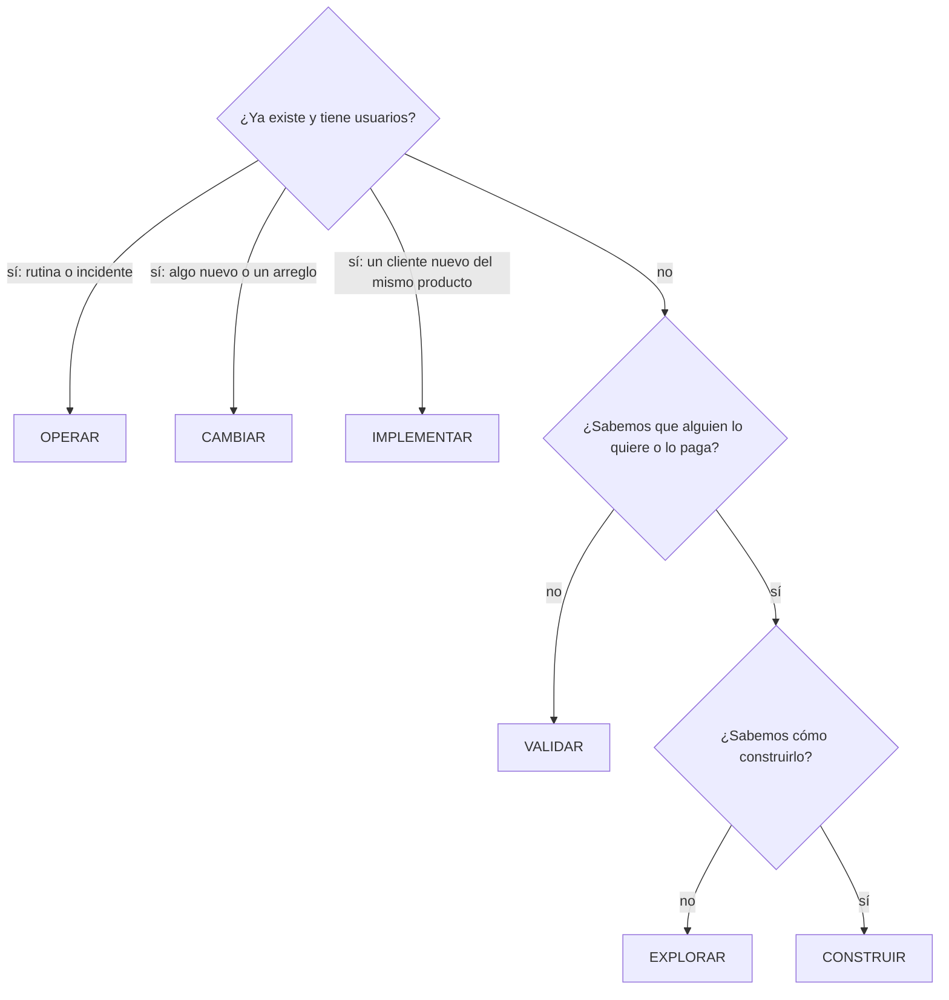

# GZSM

> **English summary.** GZSM is a scenario-based software methodology packaged as a Claude plugin. Instead of applying one heavy process to everything, a four-question selector picks one of six modules (Validate, Explore, Build, Implement, Change, Operate) and two optional layers (Collaborate, With AI). Every task then moves through the same seven stations, E0 to E6, and each station names the agent skill to use. A second skill opens and closes work sessions by reading and updating a `docs/estado.md` file, so context survives between sessions and between people. I built it from maintaining a Django ERP in production on my own. The skills and docs are written in Spanish.

GZSM es una metodología de trabajo para software y servicios tecnológicos, empaquetada como plugin de Claude. Decide **qué tipo de trabajo es cada cosa, en qué orden se hace y qué tiene que quedar escrito**. Para escribir el código usa las [skills de Matt Pocock](https://github.com/mattpocock/skills) dentro de cada etapa.

La armé mientras mantenía solo un ERP en Django en producción. El problema no era escribir código: era saber, después de una semana, en qué estado estaba cada sistema y qué seguía.

## Qué trae

| Skill | Qué hace | Cómo se pide |
|---|---|---|
| `gzsm` | Con cuatro preguntas elige el módulo, dice qué estaciones aplican, qué skill usar en cada una y cuál es el próximo paso | "GZSM: ¿qué módulo es esto?", "¿por dónde arranco?" |
| `sesion-proyecto` | "Abrí X" lee `estado.md`, los issues y los últimos commits, y propone qué hacer. "Cerrá la sesión" actualiza `estado.md` y propone issues. Nunca commitea | "Abrí X", "Cerrá la sesión" |

También trae la metodología completa ([`metodologia.md`](plugins/gzsm/skills/gzsm/references/metodologia.md)) y plantillas de [`estado.md`](plantillas/estado.md), [spec con EARS](plantillas/spec.md) y [ADR](plantillas/adr.md).

## Cómo funciona



Cuando trabaja alguien más se suma la capa **Colaborar**. Cuando el sistema tiene un LLM adentro se suma **Con IA**. Si una respuesta es "no sé", se elige el módulo más barato que la conteste, nunca Construir.

Después toda tarea recorre las mismas siete estaciones. Lo que cambia por módulo es cuáles se saltean:

| Estación | Pregunta | Skill típica |
|---|---|---|
| E0 Entrada | ¿Qué es esto? | `gzsm`, `/triage` |
| E1 Entender | ¿Qué queremos y por qué? | `/grill-with-docs`, `/research` |
| E2 Especificar | ¿Qué tiene que pasar, también cuando sale mal? | `/to-spec` con EARS |
| E3 Construir | Hacerlo | `/to-tickets`, `/implement`, `/tdd` |
| E4 Revisar | ¿Cumple la spec y los estándares? | `/code-review` |
| E5 Entregar | ¿Lo usa quien lo pidió y funciona? | Validación requisito por requisito |
| E6 Cerrar | ¿Qué quedó y qué sigue? | `sesion-proyecto` |

E2 y E6 las decide una persona. E1 y E4 se pueden delegar a un subagente.

## Ejemplo

> **Usuario:** GZSM: tenemos una herramienta que ya usa un cliente piloto y hay que decidir cómo cobrarla. ¿Qué módulo es?
>
> **Claude:** Módulo: VALIDAR + Colaborar. Por qué: la herramienta existe, pero no sabemos cuánto ni cómo van a pagar los próximos clientes; es una hipótesis comercial, no código. Estaciones: E0, E1, E2 (hipótesis), E3 (prueba real), E5 (decisión escrita), E6. Ahora: E1 → `/grill-me` sobre el modelo de cobro. Queda escrito: hipótesis de precio y después un ADR con el precio elegido y su señal de cambio.

## Instalar

**En claude.ai o en la app de escritorio:** Personalizar → Plugins → Agregar → Agregar marketplace, y pegá `https://github.com/giuliano-z/gzsm`. Después instalá `gzsm` desde la lista. Se sincroniza solo con Claude Code.

**Solo en Claude Code:**

```
/plugin marketplace add giuliano-z/gzsm
/plugin install gzsm@gzsm
```

Para que la skill `gzsm` sea útil, instalá también las [skills de Matt Pocock](https://github.com/mattpocock/skills): `claude plugin install mattpocock-skills@claude-plugins-official`.

## Estructura

```
.claude-plugin/marketplace.json     marketplace (este repo)
plugins/gzsm/
  .claude-plugin/plugin.json        manifiesto del plugin
  skills/gzsm/                      selector y estaciones
    references/metodologia.md       la metodología completa
  skills/sesion-proyecto/           abrir y cerrar sesiones
    assets/estado-template.md
plantillas/                         estado, spec (EARS) y ADR
```

## Licencia

[MIT](LICENSE) · Giuliano Zulatto
