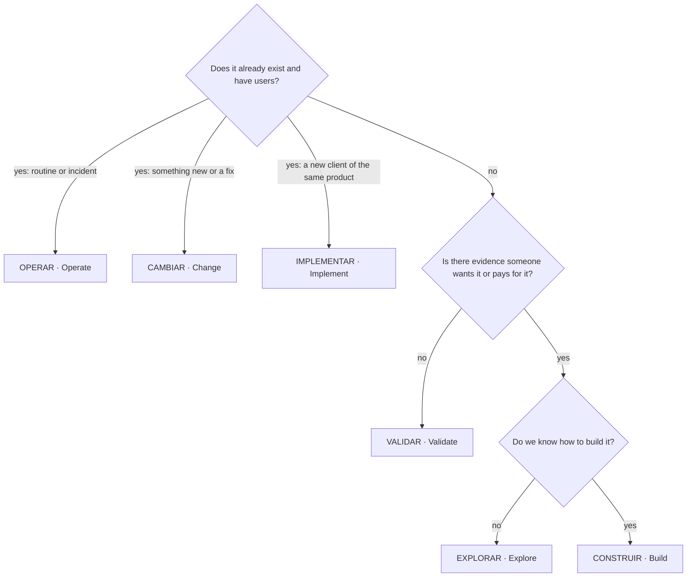

<p align="center">
  
</p>

<h1 align="center">GZSM</h1>

<p align="center">
  <strong>A scenario-based software methodology for Claude.</strong><br>
  Pick the right process for the job, then let agent skills do the work.
</p>

<p align="center">
  <a href="LICENSE"></a>
  <a href="CHANGELOG.md"></a>
  <a href="https://github.com/giuliano-z/gzsm/actions/workflows/validar.yml"></a>
  
  
</p>

<p align="center"><a href="README.es.md">Leer en español</a></p>

---

Most AI coding workflows apply one heavy process to everything: a typo fix gets the same ceremony as a new product. GZSM does the opposite. A **four-question selector** decides what kind of work you are facing, and each kind gets its own route through **seven stations**, with the checklists, templates and agent skills that route needs.

It ships as a Claude plugin with **11 skills**. It works in claude.ai, the Claude desktop app and Claude Code, and it is built to sit on top of [Matt Pocock's agent skills](https://github.com/mattpocock/skills), which do the hands-on engineering inside each station.

> **Language.** The skills and templates are written in Spanish. This README is the English entry point; the full docs are in [README.es.md](README.es.md).

## Why

GZSM came out of maintaining a Django ERP in production, alone, with an AI coding agent. Writing code was never the hard part. These were:

1. **Scattered context.** Repos, notes, chats and memory, and no single place that knew the whole picture.
2. **Processes built for building, not for running.** Recurring maintenance is not a change, it is a routine, and classic lifecycles do not capture it.
3. **Ceremony without triggers.** Good documents that nothing forces you to open or close.

## How it works



Two layers add on top of any module: **Colaborar** (more than one person) and **Con IA** (the system has an LLM inside). When an answer is "I don't know", GZSM picks the cheapest module that answers it, never Build.

Every task then moves through the same stations. Each module skips the ones it does not need.

| Station | Question | Typical skill |
|---|---|---|
| E0 Intake | What is this? | `gzsm`, `/triage` |
| E1 Understand | What do we want, and why? | `/grill-with-docs`, `/research`, `orbit` |
| E2 Specify | What must happen, including when things go wrong? | `/to-spec` plus EARS and unwanted behaviour |
| E3 Build | Do it | `/to-tickets`, `/implement`, `/tdd`, `/prototype` |
| E4 Review | Does it meet the spec and the standards? | `/code-review` |
| E5 Deliver | Does the person who asked use it, and does it work? | Validation, requirement by requirement |
| E6 Close | What is left, and what comes next? | `sesion-proyecto` |

E2 and E6 are decided by a person. E1 and E4 can be delegated to a subagent, and its output is reviewed before it is applied.

In Claude Code, plugin skills carry the plugin prefix (`/mattpocock-skills:grill-me`, `/gzsm:cambiar`); the tables use the short name. A commercial question (price, market, pricing model) goes to Validate even when the product already exists.

## Skills

| Skill | What it does | Status |
|---|---|---|
| `gzsm` | Entry point: runs the selector and routes to the module | Stable |
| `sesion-proyecto` | "Open X" reads `estado.md`, issues and commits; "close the session" updates `estado.md`. Never commits | Stable |
| `cambiar` | Change a live system: features, adaptations, preventive work and bugs, with impact analysis and user validation | Stable |
| `operar` | Routines, incidents (P1–P4, five whys, blameless postmortems), safe production writes, adoption and shutdown | Stable |
| `construir` | New system: constitution, numbered EARS specs, runbook before production | Stable |
| `colaborar` | Layer for teams: owners, PRs, where decisions live, what the agent may do | Stable |
| `validar` | Written hypotheses, the cheapest real test, a written decision | Beta |
| `orbit` | Nine axes to assess a product idea, with a Latin American lens | Beta |
| `explorar` | Throwaway prototype with a question, a time box and a discard date | Beta |
| `implementar` | Onboard a client onto a replicable product | Beta |
| `con-ia` | Layer for LLM systems: versioned prompts, evals as tests, traces | Beta |

**Stable** means used on a production system with real users. **Beta** means defined and used in specific cases.

## Quick start

**1. Install**

In claude.ai or the desktop app: **Customize → Plugins → Add → Add marketplace**, paste `https://github.com/giuliano-z/gzsm` and install `gzsm`. Claude Code picks it up the next time it starts with the same account (it shows as `gzsm@synced`).

In Claude Code only:

```
/plugin marketplace add giuliano-z/gzsm
/plugin install gzsm@gzsm
```

GZSM is most useful with Matt Pocock's skills installed too:

```
claude plugin install mattpocock-skills@claude-plugins-official
```

**2. Ask** (the skills answer in Spanish)

```
GZSM: un cliente pidió exportar a Excel el reporte mensual de un sistema que ya usa. ¿Qué módulo es?
```

```
Módulo: CAMBIAR
Por qué: el sistema existe y tiene usuarios, y el pedido es una funcionalidad nueva.
Estaciones: E0 a E6
Ahora: E1 → análisis de impacto y /grill-with-docs sobre el formato del reporte
Queda escrito: CHANGE-NNN con el impacto, la spec con comportamiento no deseado y el checklist de validación con el usuario
```

**3. Wire up a repo**

Add the GZSM block from [`claude-md.md`](plugins/gzsm/skills/construir/assets/claude-md.md) to the repo's `CLAUDE.md`, run `/setup-matt-pocock-skills` once, and start every session with "abrí [project]" and end it with "cerrá la sesión".

## Templates

| Template | Module |
|---|---|
| [Spec with EARS and unwanted behaviour](plugins/gzsm/skills/cambiar/assets/spec.md) | Build, Change |
| [Change record](plugins/gzsm/skills/cambiar/assets/change.md) · [Technical debt](plugins/gzsm/skills/cambiar/assets/deuda.md) | Change |
| [Runbook](plugins/gzsm/skills/operar/assets/runbook.md) · [Maintenance calendar](plugins/gzsm/skills/operar/assets/calendario-mantenimiento.md) · [Postmortem](plugins/gzsm/skills/operar/assets/postmortem.md) | Operate |
| [Constitution](plugins/gzsm/skills/construir/assets/constitucion.md) · [ADR](plugins/gzsm/skills/construir/assets/adr.md) · [`CLAUDE.md` block](plugins/gzsm/skills/construir/assets/claude-md.md) | Build |
| [Hypotheses](plugins/gzsm/skills/validar/assets/hipotesis.md) · [Idea (Orbit)](plugins/gzsm/skills/orbit/assets/idea.md) | Validate |
| [Prototype](plugins/gzsm/skills/explorar/assets/prototipo.md) | Explore |
| [Client onboarding](plugins/gzsm/skills/implementar/assets/checklist-alta.md) | Implement |
| [Evals](plugins/gzsm/skills/con-ia/assets/evals.md) · [Agent registry](plugins/gzsm/skills/con-ia/assets/registro-agentes.md) | With AI |
| [`estado.md`](plugins/gzsm/skills/sesion-proyecto/assets/estado-template.md) | All |

Also included: twelve [working rules for an agent on a production system](plugins/gzsm/skills/cambiar/references/reglas-de-ritmo.md), a [deploy checklist](plugins/gzsm/skills/cambiar/references/checklist-deploy.md) and a [production write protocol](plugins/gzsm/skills/operar/references/escritura-produccion.md). The full methodology is in [`metodologia.md`](plugins/gzsm/skills/gzsm/references/metodologia.md).

## Guardrails

GZSM's third principle: *anything mechanical is enforced by a check, not by a written rule.*

| Script | What it blocks |
|---|---|
| [`check-estado.sh`](scripts/check-estado.sh) | A commit that changes code without updating `docs/estado.md` |
| [`check-sensibles.sh`](scripts/check-sensibles.sh) | A commit whose added lines contain a term from a blocklist kept **outside** the repo |
| [`validar-skills.py`](scripts/validar-skills.py) | Skill frontmatter that claude.ai would reject, and broken template references (runs in CI) |

Use one as a pre-commit hook in your own repo:

```
curl -fsSL -o .git/hooks/pre-commit https://raw.githubusercontent.com/giuliano-z/gzsm/main/scripts/check-estado.sh
chmod +x .git/hooks/pre-commit
```

This replaces any existing pre-commit hook. To run both scripts, call them one after the other from a single hook.

## Principles

1. The process is chosen per scenario; it is never applied whole by default.
2. If it is not written down, it did not happen: every session closes by updating `estado.md`.
3. Anything mechanical is enforced by a check, not by a written rule.
4. Validate before you build.
5. One tool per job.
6. Nothing changes the methodology without evidence from two projects or two modules.
7. Every decision carries its change signal: the condition that forces a review.

## Foundations

GZSM borrows most of its pieces and arranges them by scenario: Spec-Driven Development, EARS, ADRs, the four ISO/IEC 14764 maintenance types, Lehman's laws, Fowler's refactoring, Lean Startup, *The Mom Test*, five whys, Google SRE's blameless postmortems, OWASP, Keep a Changelog and SemVer. [docs/fundamentos.md](docs/fundamentos.md) lists what comes from each source and what is original.

## Contributing

The most useful contribution is a **friction report**: a concrete case where the methodology fell short. There is an issue template for it. See [CONTRIBUTING.md](CONTRIBUTING.md).

## License

[MIT](LICENSE) © 2026 [Giuliano Zulatto](https://github.com/giuliano-z)
