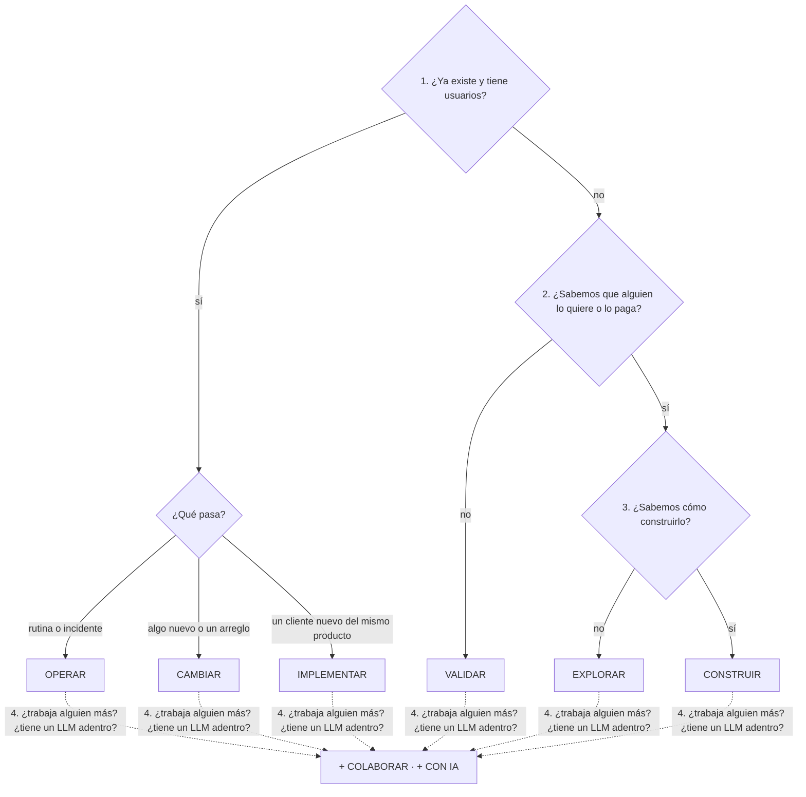
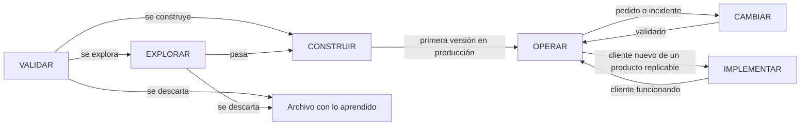

# GZSM — metodología por escenario

**Versión 1.0 · Giuliano Zulatto**

GZSM gobierna el ciclo de vida de un sistema de software o de un servicio tecnológico: qué tipo de trabajo es cada cosa, qué tiene que quedar escrito, cuándo se cierra y cómo se mantiene vivo lo que ya está en producción.

**GZSM es:** un selector, seis módulos, dos capas, siete estaciones y un puñado de reglas fijas.

**GZSM no es:** una forma de escribir código. Eso lo resuelven las skills que se usan dentro de cada estación (§4). Tampoco es un sistema de productividad personal.

## 1. Por qué existe

Nació de tres problemas que aparecen cuando una persona o un equipo pequeño mantiene varios sistemas a la vez:

1. **Información dispersa.** Repos, notas, chats con IA y memoria. Ningún lugar sabe el todo.
2. **Procesos pensados para construir, no para operar.** El mantenimiento recurrente no es un cambio, es una rutina, y los ciclos clásicos no lo capturan.
3. **Mucha ceremonia y ningún disparador.** Documentos buenos que nada pone adelante ni obliga a cerrar.

## 2. Alcance

Software y servicios tecnológicos: productos propios, sistemas a medida para clientes, productos replicables por cliente, automatizaciones, consultoría técnica, trabajos de facultad con código y repos open source.

## 3. Principios

1. **El proceso se elige por escenario.** Un bug no necesita la ceremonia de un sistema nuevo.
2. **Lo que no está escrito no pasó.** Toda sesión cierra actualizando estado, tareas y decisiones (§10).
3. **Lo mecánico se verifica con un chequeo, no con una regla escrita.** Si el control se puede automatizar, se automatiza.
4. **Validar antes de construir.** Nada pasa a Construir sin saber que alguien lo quiere.
5. **Una herramienta por trabajo.** Si dos skills hacen lo mismo, se elige una y la otra se desactiva.
6. **Nada cambia la metodología sin evidencia** (§13).
7. **Una decisión lleva su señal de cambio.** "Revisamos el hosting cuando pasemos los N clientes o los X USD por mes" evita rediscutirla cada semana.

## 4. Quién hace qué

GZSM decide **qué** se hace, en qué orden y qué queda escrito. Las skills y los conectores ejecutan **dentro** de una estación. Si mañana cambian las skills, GZSM no cambia. En Claude Code, las skills de un plugin llevan su prefijo (`/mattpocock-skills:grill-me`); aquí se usa el nombre corto.

| Trabajo | Herramienta | Notas |
|---|---|---|
| Interrogar una idea o un plan | `/grill-with-docs` (en un repo) · `/grill-me` | Skills de Matt Pocock. Dejan glosario y ADRs |
| Investigar | `/research` | Deja un `.md` con fuentes |
| Prototipo descartable | `/prototype` | |
| Escribir la spec | `/to-spec` | La publica en el gestor de issues; el bloque GZSM del `CLAUDE.md` le suma requisitos EARS y "Comportamiento no deseado" (§12) |
| Partir en tareas | `/to-tickets` | Publica issues |
| Implementar | `/implement` → `/tdd` | No commitea (§12) |
| Bugs difíciles | `/diagnosing-bugs` | |
| Revisar código | `/code-review` | Dos ejes: estándares del repo y spec |
| Glosario y ADRs | `domain-modeling` | |
| Ordenar pedidos que llegan | `/triage` | |
| Pasos que solo hace una persona | `/wizard` | Paneles de terceros, secretos |
| Interfaz y UX | UI UX Pro Max | Si el proyecto tiene identidad visual, esa manda |
| Docs de librerías | Context7 | Conector |
| Operar | Conectores del hosting, monitoreo y automatizaciones | |
| Escribir `CLAUDE.md` o skills | `writing-for-agents` | |

**Dónde se trabaja:** código de un repo, en Claude Code. Todo lo demás (pensar, decidir, operar, validar), en la app de Claude con las carpetas y los repos conectados.

## 5. El selector

Cuatro preguntas, de lo general a lo particular. La respuesta dice el módulo; la cuarta suma capas.

Si una respuesta es "no sé", se elige el módulo más barato que la conteste (Validar o Explorar), nunca Construir. Una pregunta comercial (precio, mercado, modelo de cobro) va a Validar aunque el producto ya exista.

## 6. Los seis módulos

| Módulo | Cuándo | Qué produce | Cómo termina |
|---|---|---|---|
| **Validar** | Idea sin evidencia de que alguien la quiera o la pague | Hipótesis escritas y una prueba real: entrevistas, landing con precio, preventa | Decisión escrita: se descarta, se explora o se construye |
| **Explorar** | No sabemos si se puede o cómo | Prototipo con fecha de descarte escrita | Decisión de salida escrita: se descarta, con lo aprendido, o pasa a Construir |
| **Construir** | Sistema nuevo validado | Repo con `CLAUDE.md`, glosario del dominio, ADRs, specs, issues y `estado.md` desde el día 1; runbook antes de producción | Primera versión en producción; pasa a Operar |
| **Implementar** | Cliente nuevo de un producto replicable | Instancia configurada desde una plantilla, checklist de alta, datos del cliente fuera del código | Cliente funcionando y en el runbook del producto |
| **Cambiar** | Funcionalidad, arreglo o migración sobre algo vivo | Spec (o test que reproduce el bug), issues, código, registro del cambio, bump de versión | Validación con el usuario requisito por requisito y `estado.md` al día |
| **Operar** | Rutinas, incidentes, adopción de un sistema ajeno, pausa o baja | Runbook, calendario de mantenimiento, postmortem por incidente | Es continuo; cada rutina cierra con su registro |

### Skills del plugin

| Skill | Qué cubre | Estado |
|---|---|---|
| `gzsm` | Selector de módulo y estaciones (esta guía) | Estable |
| `sesion-proyecto` | Abrir y cerrar sesiones con `estado.md` | Estable |
| `validar` | Hipótesis, prueba real y decisión escrita | Beta |
| `orbit` | Nueve ejes para evaluar una idea | Beta |
| `explorar` | Prototipo con pregunta, límite y fecha de descarte | Beta |
| `construir` | Sistema nuevo: constitución, specs, runbook antes de producción | Estable |
| `implementar` | Alta de un cliente en un producto replicable | Beta |
| `cambiar` | Funcionalidad, preventivo y bug sobre algo vivo | Estable |
| `operar` | Rutinas, incidentes, escritura en producción, adopción y baja | Estable |
| `colaborar` | Capa para trabajo con más de una persona | Estable |
| `con-ia` | Capa para sistemas con un LLM adentro | Beta |

**Estable** = usado en un sistema en producción con usuarios reales. **Beta** = definido y usado en casos puntuales.

## 7. Las dos capas

**Colaborar**: cuando trabaja alguien más (socio, empleado, grupo de facultad).
- `main` protegida y todo entra por PR.
- Cada spec e issue tiene un dueño. `ready-for-agent` y `ready-for-human` separan lo que hace un agente de lo que hace una persona.
- El mismo `CLAUDE.md` y el mismo glosario del dominio para todos.
- Las decisiones se toman en un solo lugar (ADR o issue), no en un chat, y llevan señal de cambio.
- Si se trabaja en paralelo, se escribe la señal: "si a tal fecha no está X, lo tomamos nosotros".

**Con IA**: cuando el sistema tiene un LLM adentro.
- Prompts versionados en el repo. Cambiar un prompt es un cambio con bump de versión.
- Evals como tests: conversaciones de prueba con resultado esperado, corridas en CI. Sin evals verdes no se publica.
- Salida estructurada validada con un esquema en toda herramienta que escribe datos.
- Métricas propias: costo por conversación, latencia, tasa de derivación a una persona o a un modelo de respaldo; modelo de respaldo en el runbook.
- Trazas por conversación (herramientas llamadas y argumentos), guardadas por un plazo definido.

## 8. Las siete estaciones

Toda tarea recorre las mismas estaciones. Lo que cambia por módulo es cuáles se omiten.

| Estación | Pregunta | Herramientas típicas |
|---|---|---|
| **E0 Entrada** | ¿Qué es esto? | El selector (§5), `/triage` |
| **E1 Entender** | ¿Qué queremos y por qué? | `/grill-with-docs`, `/research`, `/diagnosing-bugs` para reproducir |
| **E2 Especificar** | ¿Qué tiene que pasar, también cuando algo sale mal? | `/to-spec` con EARS, ADR |
| **E3 Construir** | Hacerlo | `/to-tickets`, `/implement`, `/tdd`, `/prototype` |
| **E4 Revisar** | ¿Cumple la spec y los estándares? | `/code-review`, checklist de deploy |
| **E5 Entregar** | ¿Lo usa quien lo pidió y funciona? | Deploy, validación requisito por requisito, runbook |
| **E6 Cerrar** | ¿Qué quedó y qué sigue? | Cierre de sesión (§10) |

| Módulo | E0 | E1 | E2 | E3 | E4 | E5 | E6 |
|---|---|---|---|---|---|---|---|
| Validar | ● | ● | hipótesis | prueba real | — | decisión | ● |
| Explorar | ● | ● | límites | prototipo | — | decisión de salida | ● |
| Construir | ● | ● | ● | ● | ● | ● | ● |
| Implementar | ● | checklist | — | configuración | ● | ● | ● |
| Cambiar (funcionalidad) | ● | ● | ● | ● | ● | ● | ● |
| Cambiar (bug) | ● | reproducir | test rojo = spec | ● | ● | ● | ● |
| Operar | ● | — | — | rutina o incidente | — | ● | ● |

## 9. Fuente de verdad

Cada pregunta tiene un solo lugar donde se responde.

| Pregunta | Dónde vive |
|---|---|
| ¿Qué hay que hacer y quién? | Issues del repo |
| ¿Cómo va todo, de un vistazo? | Un tablero alimentado por los issues |
| ¿Dónde estamos y qué sigue? | `docs/estado.md` del repo |
| ¿Por qué es así? | ADRs del repo |
| ¿Cómo le decimos a las cosas? | Glosario del dominio del repo (`GLOSSARY.md`) |
| ¿Qué cambió y en qué versión? | `CHANGELOG.md` y el registro de cada cambio |
| ¿Cómo se mantiene vivo? | `docs/runbook.md` y el calendario de mantenimiento |
| ¿Qué reglas sigue el agente? | `CLAUDE.md` del repo, corto y con punteros |

Cada issue está en Activa, Esperando a alguien, Algún día o Hecha, y tiene dueño. "Esperando a alguien" dice a quién.

## 10. Sesiones: abrir y cerrar

**Abrir:** "abrí X". Claude lee `estado.md`, los issues abiertos y los últimos commits, y propone qué hacer hoy.

**Cerrar:** "cerrá la sesión". Claude actualiza `estado.md` (última sesión, decisiones, próximo paso), propone issues y registra lo que haya cambiado (cambio, ADR, deuda). Regla fija, sin excepción.

**Red de seguridad sugerida:** un pre-commit que rechaza el commit si cambió código y no cambió `estado.md`, y una tarea programada que compara los commits del día con cada `estado.md` y avisa cuál quedó viejo.

## 11. Agentes

| Tipo | Qué es | Dónde entra |
|---|---|---|
| **Subagente** | Otro Claude con un encargo pequeño y escrito, que vuelve con un resultado | E1 Entender (investigar) y E4 Revisar (revisor con contexto limpio) |
| **Agente autónomo** | Corre sin una persona: tareas programadas, workflows | Operar: chequeos recurrentes |
| **Agente como producto** | Un LLM con herramientas, memoria y reglas que atiende usuarios | Capa Con IA |

- E1 y E4 se pueden delegar. E2 Especificar y E6 Cerrar no: son decisiones de una persona.
- La salida de un subagente se revisa antes de aplicarse.
- Todo agente tiene un registro con nombre, qué lo dispara, qué puede tocar, costo y última revisión. Un agente sin dueño ni lector se apaga.

## 12. Reglas fijas

1. **Cierre de sesión obligatorio** (§10).
2. **Git:** el agente no corre comandos de git que escriban en repos personales; los commits los hace una persona. En repos compartidos puede crear ramas y abrir PRs, nunca mergear ni pushear a `main`.
3. **Escritura en producción:** diff aprobado, prueba en seco, verificación de que se apunta a la base correcta, snapshot y verificación independiente.
4. **En Construir y Cambiar, nada se cierra sin correr en producción** con datos reales y sin la validación del usuario.
5. **El output crudo es la única fuente de verdad**, nunca el resumen de un agente.

Tres enganches con las skills de Matt Pocock, escritos en el `CLAUDE.md` de cada repo para que una actualización de las skills no los pise:

1. **La spec lleva "Comportamiento no deseado"** en EARS: "SI [situación no deseada], ENTONCES el sistema [respuesta]".
2. **`/implement` no commitea.** Termina mostrando el diff y el mensaje de commit propuesto.
3. **Los ADRs van donde el repo ya los tiene.** En repos nuevos, `docs/adr/0001-slug.md`.

## 13. Cómo cambia la metodología

Un cambio entra a GZSM cuando el mismo patrón aparece en dos proyectos **o** en dos módulos distintos. Las fricciones se registran antes de cambiar nada.
